# ✈️ Agencia de Viajes — PFY2202

SPA de agencia de viajes para la actividad **sumativa de la Semana 5** de
**Desarrollo Frontend II (PFY2202)**.

La aplicación consume **dos APIs simuladas con MSW** al mismo tiempo:

- **REST** (`GET /api/destinos`) → lista de destinos con país y actividades.
- **GraphQL** (`query DetalleDestino` + `mutation CrearReserva`) → vuelos,
  hoteles y confirmación de la reserva.

Al seleccionar un destino se muestran sus vuelos y hoteles, con estados de
carga, error y datos vacíos. El usuario puede **agregarlos a una reserva**
(carrito), ajustar pasajeros/noches y confirmar el checkout contra el mock
GraphQL.

> **Demo:** https://cristianjtm.github.io/viajes-cristian-torres-PFY2202/

---

## 🧰 Stack

| Tecnología | Uso |
|---|---|
| React 18.3.1 | UI basada en componentes funcionales y hooks |
| Vite 5 | Dev server y build |
| React Router 7 | Ruteo (`react-router`, no `react-router-dom`) |
| MSW 2.x | Mock de REST y GraphQL en el mismo service worker |
| Apollo Client 3 | GraphQL (`useQuery` y `useMutation`) |
| Tailwind CSS 3 | Estilos (PostCSS) |

---

## ✨ Funcionalidades

- **Home**: grilla responsive de destinos cargada desde la API REST.
- **Detalle**: vuelos y hoteles del destino desde GraphQL, con la fecha del
  vuelo y el período de disponibilidad del hotel.
- **Reserva/carrito**: agrega vuelos y hoteles disponibles, ajusta la cantidad
  (pasajeros/noches), ve subtotales y total, y quita ítems.
- **Checkout validado**: nombre, email y fecha de viaje; estado de carga y
  manejo de error.
- **Confirmación**: mutación GraphQL `CrearReserva` que devuelve un código
  (`RSV-…`) y el total recalculado en el mock.
- **Persistencia**: el carrito sobrevive al refresh vía `localStorage`.
- **Navbar persistente** con contador de destinos y badge de la reserva
  (contextos compartidos).
- **Estados de UI**: `LoadingSpinner` mientras carga, `ErrorMessage` con botón
  de reintento (REST) y mensaje amigable si no hay vuelos/hoteles.
- **Ruteo SPA** con `Link`/`NavLink` (sin recargas de página).
- **404** para rutas inexistentes.
- **Listo para GitHub Pages** (base dinámica, `basename` del router y
  `404.html` para deep links).

---

## 📁 Estructura

```text
src/
├─ mocks/
│  ├─ catalogo.js         # FUENTE ÚNICA: destinos + vuelos + hoteles
│  ├─ handlers.js         # handlers REST, query y mutation GraphQL
│  └─ browser.js          # setupWorker(...handlers)
├─ lib/
│  ├─ api.js              # API_BASE, ApiError, pedirJson()
│  ├─ apolloClient.js     # ApolloClient -> <BASE_URL>graphql
│  ├─ formato.js          # helpers de precio y fecha
│  ├─ limites.js          # CANTIDAD_MIN / CANTIDAD_MAX compartidos
│  └─ validarCheckout.js  # reglas del formulario de checkout (puras)
├─ context/
│  ├─ DestinosContext.jsx # consulta REST compartida (Navbar + Home)
│  └─ ReservaContext.jsx  # carrito global (useReducer + localStorage)
├─ pages/
│  ├─ Home.jsx
│  ├─ DetalleDestino.jsx
│  ├─ Carrito.jsx
│  └─ NotFound.jsx
├─ components/
│  ├─ layout/
│  │  ├─ AppLayout.jsx
│  │  └─ Navbar.jsx
│  └─ ui/
│     ├─ LoadingSpinner.jsx
│     ├─ ErrorMessage.jsx
│     ├─ DestinoCard.jsx
│     ├─ VueloCard.jsx
│     ├─ HotelCard.jsx
│     ├─ CantidadControl.jsx
│     ├─ ResumenReserva.jsx
│     └─ ReservaExitosa.jsx
├─ hooks/
│  └─ useDestinos.js       # fetch REST + loading/error/retry + AbortController
├─ App.jsx                # ApolloProvider + BrowserRouter + Routes
└─ main.jsx               # enableMocking() antes del render
```

---

## 🗺️ Rutas

| Ruta | Componente | Datos |
|---|---|---|
| `/` | `Home` | REST (`GET /api/destinos`) |
| `/destino/:slug` | `DetalleDestino` | GraphQL (`DetalleDestino`) |
| `/carrito` | `Carrito` | Estado global + GraphQL (`CrearReserva`) |
| `*` | `NotFound` | — |

---

## 🔌 Contrato de los mocks

### REST — `GET /api/destinos`

- `delay(1000)`.
- **200** → array de destinos: `{ slug, nombre, pais, emoji, descripcion, actividades[] }`.
- **500** → `{ error: 'Error del servidor' }` si se agrega `?fail=500`.

**Cómo probar el error REST:** abre `/?fail=500` (en local
`http://localhost:5173/?fail=500`, en Pages
`https://cristianjtm.github.io/viajes-cristian-torres-PFY2202/?fail=500`). Home
muestra `ErrorMessage` con el botón **Reintentar**. Mientras el parámetro siga
en la URL el reintento volverá a fallar: es intencional, para demostrar el
estado de error.

### GraphQL — `POST /graphql`

```graphql
type Vuelo {
  id: ID!
  aerolinea: String!
  origen: String!
  destino: String!
  precio: Float!
  fecha: String!
  disponible: Boolean!
}

type Hotel {
  id: ID!
  nombre: String!
  categoria: String!
  precioNoche: Float!
  disponibleDesde: String!
  disponibleHasta: String!
  disponible: Boolean!
}

type ReservaItem {
  id: ID!
  tipo: String!
  titulo: String!
  cantidad: Int!
  precio: Float!
}

type Reserva {
  codigo: String!
  estado: String!
  total: Float!
  cliente: String!
  email: String!
  fechaViaje: String
  creadaEn: String!
  items: [ReservaItem!]!
}

input ReservaItemInput {
  id: ID!
  tipo: String!
  titulo: String!
  cantidad: Int!
  precio: Float!
}

input CrearReservaInput {
  cliente: String!
  email: String!
  fechaViaje: String
  items: [ReservaItemInput!]!
}

type Query {
  vuelos(slug: String!): [Vuelo!]!
  hoteles(slug: String!): [Hotel!]!
}

type Mutation {
  crearReserva(input: CrearReservaInput!): Reserva!
}
```

Query consumida por Apollo:

```graphql
query DetalleDestino($slug: String!) {
  vuelos(slug: $slug) {
    id aerolinea origen destino precio fecha disponible
  }
  hoteles(slug: $slug) {
    id nombre categoria precioNoche disponibleDesde disponibleHasta disponible
  }
}
```

Mutation consumida por Apollo:

```graphql
mutation CrearReserva($input: CrearReservaInput!) {
  crearReserva(input: $input) {
    codigo
    estado
    total
    cliente
    email
    fechaViaje
    creadaEn
    items { id tipo titulo cantidad precio }
  }
}
```

- `delay(1000)` en los handlers.
- Slug inexistente → respuesta con `errors` (HTTP 200, **no** HTTP 404).
- Los **vuelos** traen `fecha` (día del vuelo) y los **hoteles** traen
  `disponibleDesde`/`disponibleHasta`, un período de disponibilidad que la
  tarjeta muestra formateado (p. ej. “Disponibilidad: 1 dic 2026 – 15 ene 2027”).
- La mutación toma **título, tipo y precio del catálogo** (`getItemCatalogo`) y
  recalcula el total en el mock: no confía en precios ni total enviados por el
  cliente. Un `id` inexistente devuelve `errors`.
- Cantidades válidas: 1–30 (misma constante en carrito, control y mock:
  `src/lib/limites.js`).
- Trigger de error determinista: usar `error@test.com` como email devuelve
  `errors` para probar el estado de error de la UI.

> `catalogo.js` es la **única fuente de datos**. El handler REST elimina
> `vuelos`/`hoteles`, y el handler GraphQL los lee del mismo destino, por lo que
> un slug nunca queda desincronizado.

> **Datos vacíos:** si un destino no tuviera vuelos u hoteles, `DetalleDestino`
> muestra un mensaje amigable en lugar de una grilla vacía
> (`src/pages/DetalleDestino.jsx`). El catálogo actual trae 3 vuelos y 3 hoteles
> por destino, así que ese estado se verifica en código, no con los datos de
> ejemplo.

---

## 🛒 Reserva / carrito

1. En `/destino/:slug`, cada vuelo/hotel **disponible** muestra
   **“+ Agregar a la reserva”**; si ya está, el botón indica **“✓ En la reserva”**
   y vuelve a quitarlo. Los ítems **agotados** quedan deshabilitados.
2. El **Navbar** muestra `🛒 Reserva` con un badge que refleja la cantidad de
   ítems distintos.
3. En `/carrito`:
   - se listan los ítems agrupados en vuelos y hoteles;
   - `CantidadControl` ajusta **pasajeros** (vuelo) o **noches** (hotel), entre
     1 y 30;
   - se muestran subtotales por línea y el **total**;
   - se pueden quitar ítems individuales o vaciar la reserva.
4. El **checkout** valida nombre (mín. 3), email y fecha de viaje (hoy o
   posterior) antes de enviar.
5. Al confirmar se ejecuta la mutación `CrearReserva`. Si responde bien:
   - se muestra el **código de reserva** y el total;
   - el carrito se vacía **solo en ese caso**.
   Si falla, se muestra `ErrorMessage` y **los ítems se conservan**.
6. El carrito se persiste en `localStorage` (clave `viajes:reserva:v1`), por lo
   que sobrevive a un refresh. La lectura usa `try/catch` y valida la forma de
   los ítems.

**Estado:** `ReservaContext.jsx` usa `useReducer` con las acciones `AGREGAR`,
`QUITAR`, `CAMBIAR_CANTIDAD` y `VACIAR`, y expone `items`, `total`,
`cantidadItems`, `agregar`, `quitar`, `cambiarCantidad`, `vaciar` y
`estaEnReserva`.

---

## 🚀 Ejecutar en local

```bash
npm install
npx msw init ./public --save   # genera public/mockServiceWorker.js
npm run dev
```

Abrir http://localhost:5173/ (el mock se activa automáticamente en desarrollo).

### Scripts

| Script | Descripción |
|---|---|
| `npm run dev` | Dev server con mock activo |
| `npm run build` | Build normal (mock desactivado) |
| `npm run build:pages` | Build para GitHub Pages (base del repo + mock activo + `404.html`) |
| `npm run preview` | Previsualiza el build normal |
| `npm run preview:pages` | Previsualiza el build de Pages en su subruta |
| `npm run evidencias` | Regenera las capturas de `docs/evidencias/` con Playwright |
| `npm run deploy` | Publica `dist/` en la rama `gh-pages` |

---

## 🌐 Despliegue en GitHub Pages

El repositorio ya está configurado (`origin` → `CristianJTM/viajes-cristian-torres-PFY2202`)
y GitHub Pages sirve la rama `gh-pages`.

Para publicar cambios:

```bash
git add .
git commit -m "feat: descripción del cambio"
git push origin main
npm run deploy
```

`predeploy` ejecuta `build:pages`, que:

- aplica `base = '/viajes-cristian-torres-PFY2202/'`,
- activa MSW también en producción (`MODE === 'pages'`),
- genera `dist/404.html` para que los deep links (`/destino/paris`) funcionen,
- genera `dist/.nojekyll` para que Jekyll no interfiera con los archivos del
  SPA en GitHub Pages.

---

## ✅ Pruebas en navegadores

Verificación **asistida** sobre el **build de Pages**
(`npm run build:pages` + `npm run preview:pages`), es decir, el mismo artefacto
que se publica en GitHub Pages, navegando por la subruta
`/viajes-cristian-torres-PFY2202/`. Las capturas de cada escenario se generan
con `npm run evidencias` (Playwright) y quedan en `docs/evidencias/`.

| Navegador | Versión probada | Resultado |
|---|---|---|
| Chrome | 158.0.8127.37 | 12/12 escenarios ✅, consola sin errores de la app |
| Edge | 158.0.4370.45 | 12/12 escenarios ✅, consola sin errores de la app |
| Firefox | 159.0 (Playwright) | 12/12 escenarios ✅, consola sin errores de la app |

### Matriz de escenarios

| # | Escenario | Chrome | Edge | Firefox |
|---|---|---|---|---|
| 1 | Home muestra los 4 destinos (REST) | ✅ | ✅ | ✅ |
| 2 | `/destino/paris` muestra 3 vuelos + 3 hoteles (GraphQL) | ✅ | ✅ | ✅ |
| 3 | Slug inexistente → error GraphQL | ✅ | ✅ | ✅ |
| 4 | `/?fail=500` → error REST y botón Reintentar | ✅ | ✅ | ✅ |
| 5 | Ruta inválida → página 404 | ✅ | ✅ | ✅ |
| 6 | Agregar vuelo y hotel → badge del Navbar en 2 | ✅ | ✅ | ✅ |
| 7 | Carrito: 2 ítems y total $1.240.000 | ✅ | ✅ | ✅ |
| 8 | Refresh → carrito y total persisten (localStorage) | ✅ | ✅ | ✅ |
| 9 | Checkout válido → código `RSV-…`, total y carrito vaciado | ✅ | ✅ | ✅ |
| 10 | Email `error@test.com` → error visible y carrito conservado | ✅ | ✅ | ✅ |
| 11 | Submit inválido → errores inline (nombre, email, fecha) | ✅ | ✅ | ✅ |
| 12 | Deep links bajo la subruta de Pages (`/carrito`, `/destino/:slug`) | ✅ | ✅ | ✅ |

### Cómo reproducir

```bash
npm run build:pages
npm run preview:pages   # http://localhost:4173/viajes-cristian-torres-PFY2202/
```

1. Abre la raíz de la subruta y espera ~1 s: aparecen los 4 destinos (REST).
2. Entra a `/destino/paris` y espera ~1 s: 3 vuelos y 3 hoteles (GraphQL).
3. Abre `/destino/no-existe`: `ErrorMessage` de GraphQL (HTTP 200 con `errors`).
4. Abre `/?fail=500`: `ErrorMessage` de REST con botón **Reintentar**.
5. Abre una ruta inválida: página 404 con link de vuelta.
6. Agrega un vuelo y un hotel: el badge del Navbar queda en 2.
7. Entra a `/carrito`: 2 ítems con subtotales y total.
8. Recarga `/carrito`: los ítems persisten vía `localStorage`.
9. Confirma con datos válidos: código `RSV-…`, total y carrito vaciado.
10. Confirma con `error@test.com`: error visible y los ítems se conservan.
11. Envía el formulario vacío: errores inline en nombre, email y fecha.
12. Abre directo `/carrito` y `/destino/paris`: los deep links resuelven
    gracias a `404.html`.

Repite la matriz en escritorio y en vista móvil (DevTools, 375 px) para validar
el layout responsive.

### 📸 Evidencias visuales

Capturas reales del build de Pages, generadas con `npm run evidencias`
(`scripts/capturar-evidencias.mjs` + Playwright). El nombre de cada archivo indica
navegador, viewport y escenario; todas están en `docs/evidencias/`.

#### Home — REST (`/`)
<table>
  <tr>
    <td align="center"><b>Chrome · 1366×900</b></td>
    <td align="center"><b>Edge · 1366×900</b></td>
    <td align="center"><b>Firefox · 1366×900</b></td>
  </tr>
  <tr>
    <td>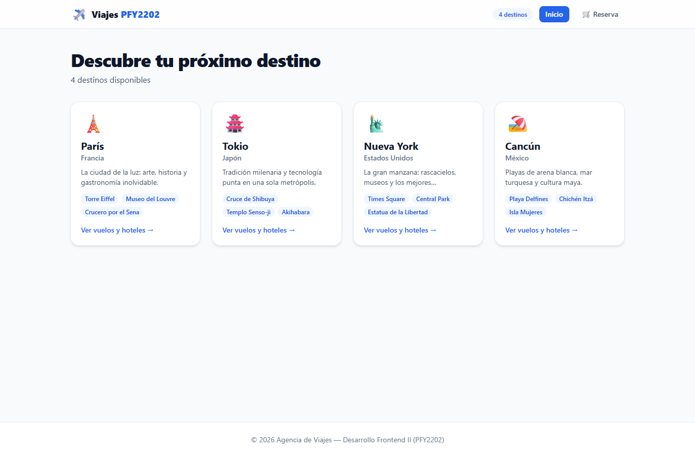</td>
    <td></td>
    <td>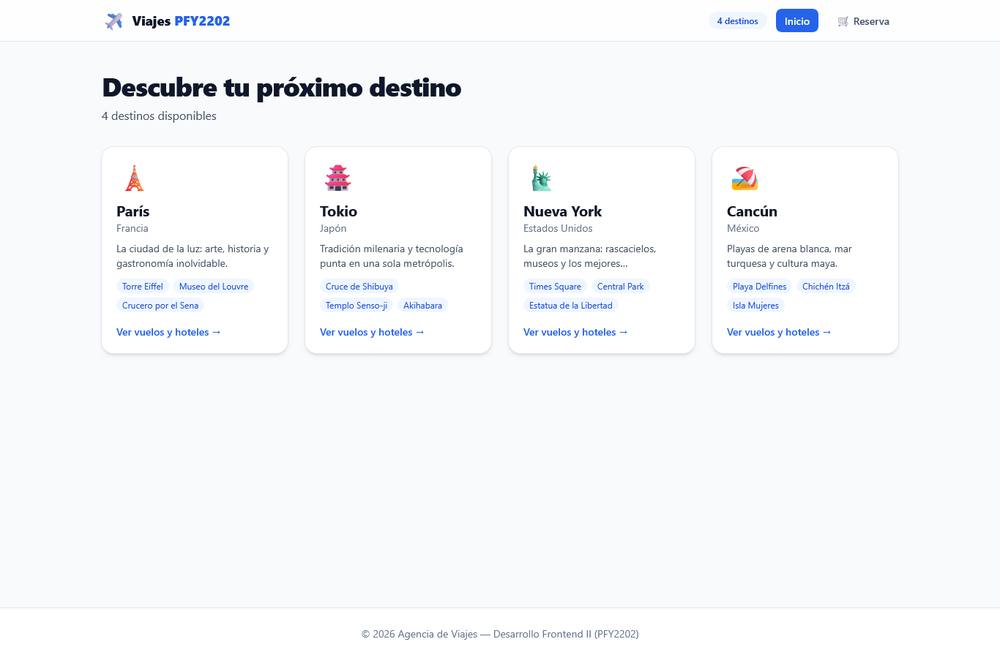</td>
  </tr>
</table>

#### Detalle del destino — GraphQL (`/destino/paris`)
<table>
  <tr>
    <td align="center"><b>Chrome · 1366×900</b></td>
    <td align="center"><b>Edge · 1366×900</b></td>
    <td align="center"><b>Firefox · 1366×900</b></td>
  </tr>
  <tr>
    <td></td>
    <td>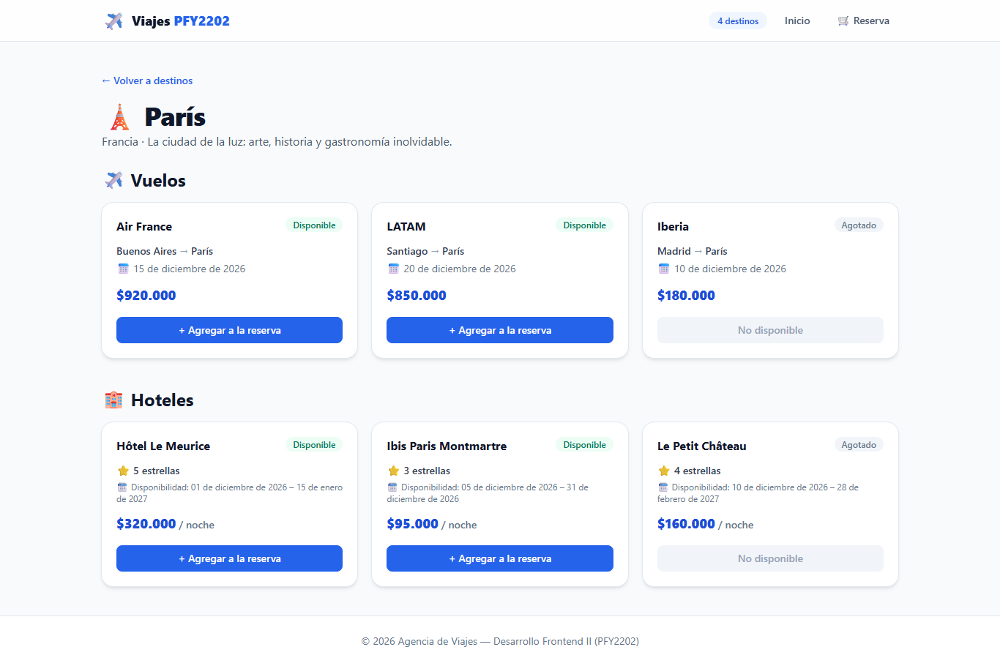</td>
    <td>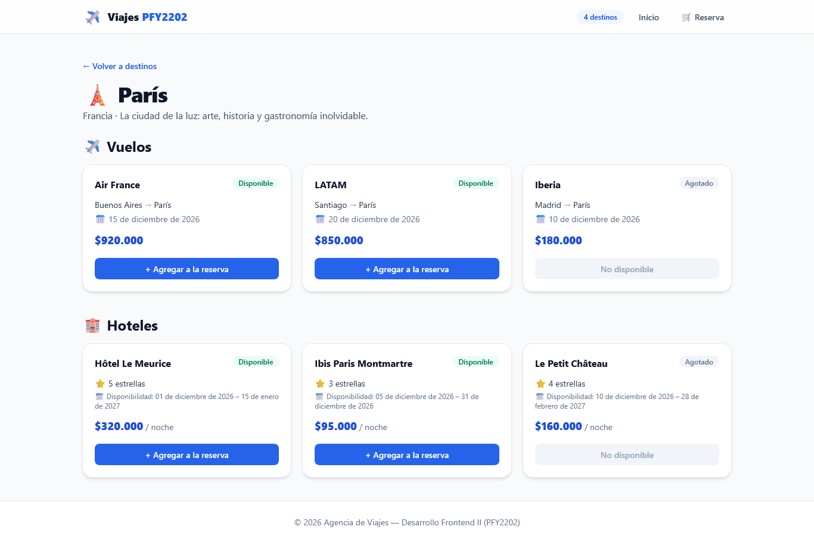</td>
  </tr>
</table>

#### Carrito y checkout (`/carrito`)
<table>
  <tr>
    <td align="center"><b>Chrome · 1366×900</b></td>
    <td align="center"><b>Edge · 1366×900</b></td>
    <td align="center"><b>Firefox · 1366×900</b></td>
  </tr>
  <tr>
    <td>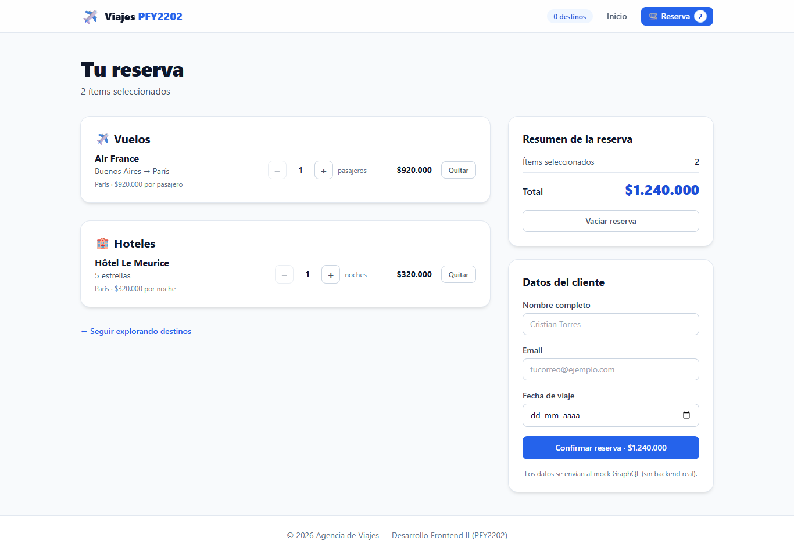</td>
    <td></td>
    <td>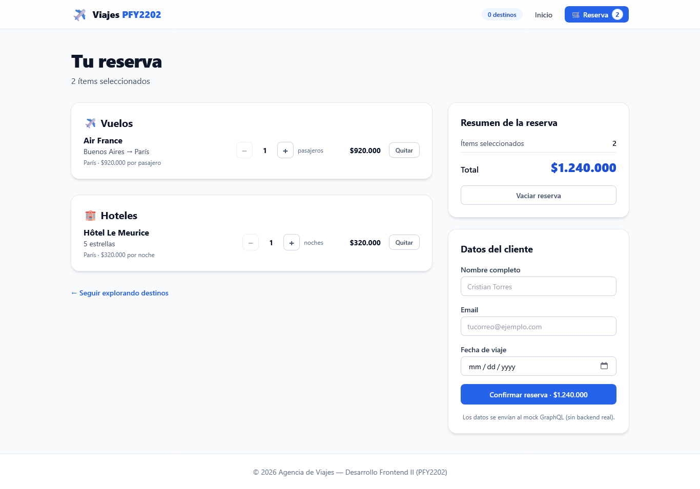</td>
  </tr>
</table>

#### Error GraphQL — slug inexistente (`/destino/no-existe`)
<table>
  <tr>
    <td align="center"><b>Chrome · 1366×900</b></td>
    <td align="center"><b>Edge · 1366×900</b></td>
    <td align="center"><b>Firefox · 1366×900</b></td>
  </tr>
  <tr>
    <td></td>
    <td>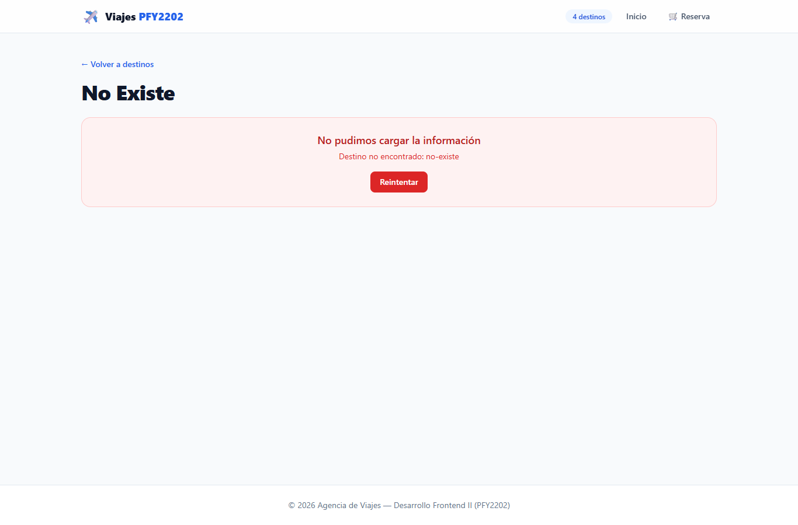</td>
    <td>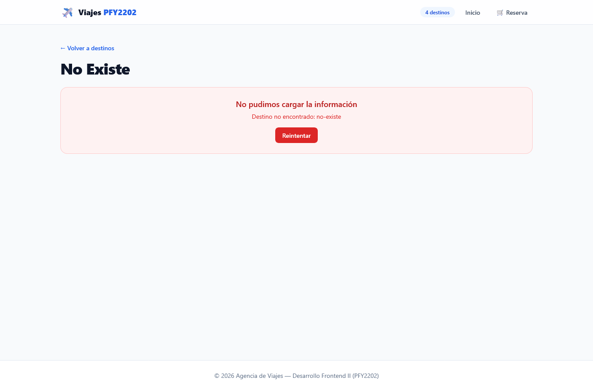</td>
  </tr>
</table>

#### Error REST (`/?fail=500`)
<table>
  <tr>
    <td align="center"><b>Chrome · 1366×900</b></td>
    <td align="center"><b>Edge · 1366×900</b></td>
    <td align="center"><b>Firefox · 1366×900</b></td>
  </tr>
  <tr>
    <td>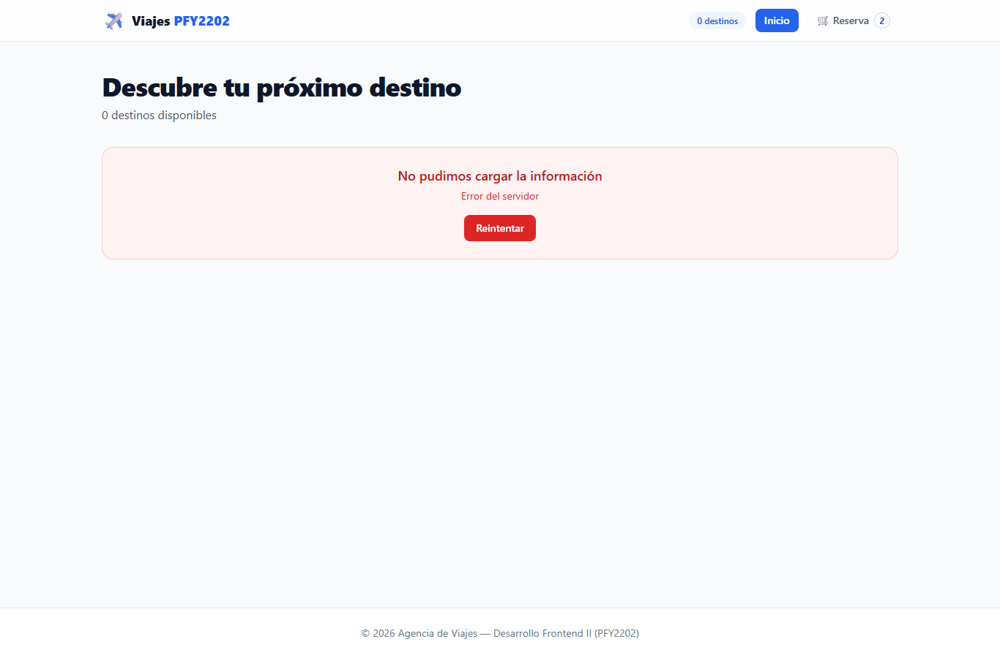</td>
    <td></td>
    <td></td>
  </tr>
</table>

#### 404 — ruta inexistente
<table>
  <tr>
    <td align="center"><b>Chrome · 1366×900</b></td>
    <td align="center"><b>Edge · 1366×900</b></td>
    <td align="center"><b>Firefox · 1366×900</b></td>
  </tr>
  <tr>
    <td>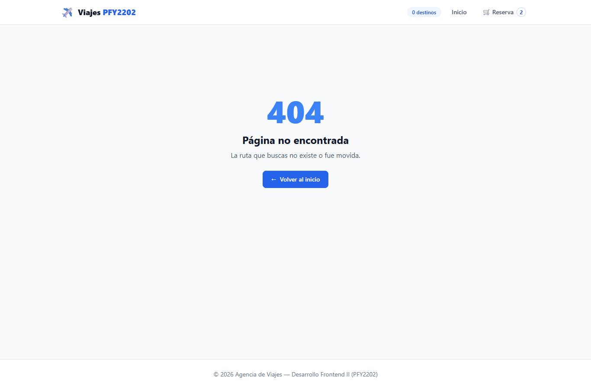</td>
    <td></td>
    <td></td>
  </tr>
</table>

#### Vista móvil — 375×812
<table>
  <tr>
    <td align="center"><b>Chrome</b></td>
    <td align="center"><b>Edge</b></td>
    <td align="center"><b>Firefox</b></td>
  </tr>
  <tr>
    <td></td>
    <td>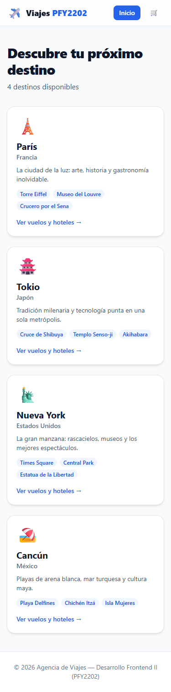</td>
    <td></td>
  </tr>
  <tr>
    <td align="center">Home</td>
    <td align="center">Home</td>
    <td align="center">Home</td>
  </tr>
  <tr>
    <td></td>
    <td></td>
    <td>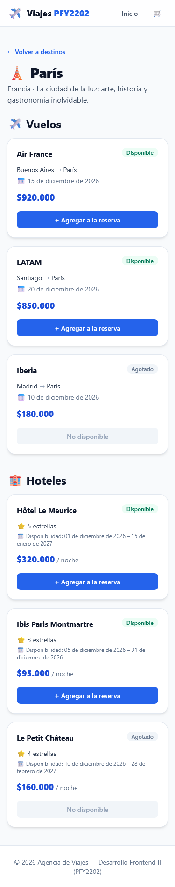</td>
  </tr>
  <tr>
    <td align="center">Detalle</td>
    <td align="center">Detalle</td>
    <td align="center">Detalle</td>
  </tr>
</table>

---

## 👤 Autor

Cristian Torres — Desarrollo Frontend II (PFY2202), Semana 5.
